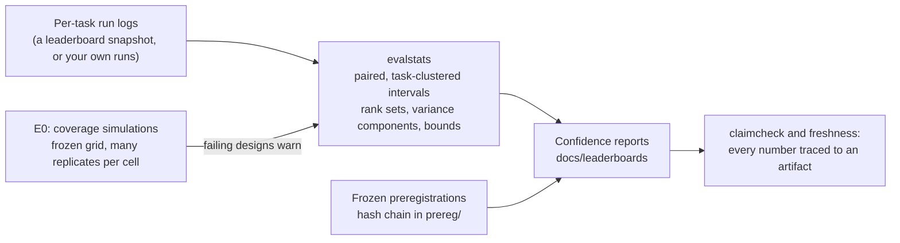

# noise-floor

[](https://github.com/raj200501/noise-floor/actions/workflows/ci.yml)

**How much of a leaderboard gap is the model, and how much is noise?**

noise-floor tells you which differences between AI agents on a benchmark the data can resolve.
Its library, **evalstats**, takes one row per run, or reads Inspect AI logs, Harbor job
directories, and SWE-bench evaluation results directly, and answers the questions a single
leaderboard score skips: is agent A ahead of agent B on the same tasks, which entries could
plausibly rank first, how many tasks and runs a comparison needs, and whether an ordering
survives a different scoring of timeouts and infrastructure errors. It warns when an interval
method is used on a design as small as one where its coverage check failed in simulation. This
repository applies it to public agent leaderboards; a preregistered study of how much of agent
success comes from the model rather than the harness and run settings
([E1](#e1-the-preregistered-factorial-study)) is frozen and has no results yet. Every result
number on this page is generated from a banked artifact and checked by `make claimcheck`.

**Headline finding.** On the public Terminal-Bench 2.0 leaderboard, only <!-- claim:e2.tb2.adjacent.supported -->2
of <!-- claim:e2.tb2.adjacent.pairs -->65 adjacent pairs are statistically separated, and <!-- claim:e2.tb2.first -->15
of its <!-- claim:e2.tb2.entries -->66 entries could plausibly rank first. The top two submissions
differ by <!-- claim:e2.tb2.top.diff -->+0.018 in task success (95% paired CI [<!-- claim:e2.tb2.top.lo -->-0.041, <!-- claim:e2.tb2.top.hi -->+0.077]), so their order is not statistically supported.
In an exploratory check (not preregistered), the smallest gap the board's design detects
with 80% power (median over adjacent pairs) is <!-- claim:nf.tb2.mde -->0.097, while the median
adjacent gap is <!-- claim:nf.tb2.gap -->0.007; only <!-- claim:nf.tb2.atleast -->1 of the <!-- claim:e2.tb2.adjacent.pairs -->65
adjacent gaps reaches its pair's detectable gap. Where the data do resolve a gap, the analysis
reports it: on SWE-bench Verified, <!-- claim:e2.epoch.adjacent.supported -->3 of <!-- claim:e2.epoch.adjacent.pairs -->31 adjacent pairs are
separated, among them the leader's margin over second
(<!-- claim:e2.epoch.top.diff -->+0.041, CI <!-- claim:e2.epoch.top.lo -->+0.010 to <!-- claim:e2.epoch.top.hi -->+0.073). The same arithmetic sizes your own
evals: from a pilot's results, `mde` gives the smallest gap a design detects at a chosen power,
and `tasks_needed` gives the number of tasks a target gap requires.

Why it matters: boards like these rest on tens to hundreds of tasks with few runs each, and their
scores move with more than the model ([Segato (Anthropic)](https://www.anthropic.com/research/infrastructure-noise)
reports that container resource settings moved Terminal-Bench 2.0 scores by several percentage
points for Claude models). An ordering the data do not support is not evidence that one entry is
better.


Each row of the figure is the gap between two neighbouring Terminal-Bench entries with its paired
interval; where the interval crosses zero, the data do not support that ordering.

| Leaderboard (confidence report) | Entries | Tasks | Adjacent pairs separated | Median rank-interval width | Could rank first | Detectable gap* | Median adjacent gap* |
|---|---:|---:|---:|---:|---:|---:|---:|
| [Terminal-Bench 2.0](docs/leaderboards/tb2.md) | <!-- claim:e2.tb2.entries -->66 | <!-- claim:e2.tb2.tasks -->89 | <!-- claim:e2.tb2.adjacent.supported -->2 of <!-- claim:e2.tb2.adjacent.pairs -->65 | <!-- claim:e2.tb2.rankwidth -->35 ranks | <!-- claim:e2.tb2.first -->15 | <!-- claim:nf.tb2.mde -->0.097 | <!-- claim:nf.tb2.gap -->0.007 |
| [SWE-bench Verified (Epoch AI)](docs/leaderboards/epoch-swebench.md) | <!-- claim:e2.epoch.entries -->32 | <!-- claim:e2.epoch.tasks -->454 | <!-- claim:e2.epoch.adjacent.supported -->3 of <!-- claim:e2.epoch.adjacent.pairs -->31 | <!-- claim:e2.epoch.rankwidth -->21 ranks | <!-- claim:e2.epoch.first -->4 | <!-- claim:nf.epoch.mde -->0.048 | <!-- claim:nf.epoch.gap -->0.004 |

Pairs are separated when their paired, task-clustered 95% interval excludes zero; rank intervals
are simultaneous 95% intervals from a task bootstrap on the tasks every entry attempted (the Tasks
column). The unstarred columns follow plans frozen before any interval, ordering test, or rank set
was computed ([`prereg/0001`](prereg/0001-e2-leaderboard-reanalysis.md), amended for SWE-bench
Verified by [`prereg/0002`](prereg/0002-e2-amend-epoch-reference-rule.md)). *Exploratory, not
preregistered ([script](tools/noise_floor.py), [artifact](artifacts/e2/noise_floor.json)): a
pair's detectable gap is the smallest true difference in success rate that its design detects with
80% power at two-sided alpha 0.05 (normal approximation); both starred columns are medians over
adjacent pairs, and only <!-- claim:nf.tb2.atleast -->1 and <!-- claim:nf.epoch.atleast -->2 pairs,
respectively, have a gap at least as large as their own detectable gap.

**Quickstart.** Install the library; its only dependencies are NumPy, SciPy, and pandas:

```bash
pip install "git+https://github.com/raj200501/noise-floor"   # Python 3.11 or later
```

Then give it one row per run:

```python
from evalstats import paired_difference, rank_confidence, read_csv
from evalstats import design_from_results, tasks_needed

results = read_csv("my_runs.csv")  # columns: model, task, run, outcome (a score in [0, 1])

cmp = paired_difference(results, "agent-a", "agent-b")  # paired by task, clustered on tasks
d = cmp.difference
print(f"A - B = {d.estimate:+.3f}, 95% CI [{d.lo:+.3f}, {d.hi:+.3f}], separated: {cmp.supported}")

ranks = rank_confidence(results, seed=0)  # simultaneous 95% rank intervals for every entry
print("could rank first:", ranks.top_set)

design = design_from_results(results, "agent-a", "agent-b")
print("tasks for a 0.03 gap at 3 runs each:", tasks_needed(0.03, design, runs_per_task=3))
```

From the shell, `evalstats report my_runs.csv` writes a Markdown confidence report for your own
runs: each entry's simultaneous rank interval, every adjacent ordering with its paired interval,
and, for runs with a status, bounds over every way of scoring the ambiguous ones. `--from inspect`
or `--from harbor` reads a harness's own output directly. No results of your own yet? In a clone,
`make setup && make demo` runs evalstats offline on a synthetic fixture with planted effects (no
model calls; needs uv).

**Why these numbers hold up.** Each safeguard below is a check you can run, not a promise:

- *Plans before data.* Every confirmatory analysis follows a preregistration that was frozen,
  hashed, and committed before its data existed; `make prereg-verify` checks the order.
- *No hand-typed numbers.* Each result number on this page carries a hidden marker that ties it
  to a banked artifact; `make claimcheck` and `make freshness` fail if any of them drifts.
- *Intervals tested before use.* The score, paired, and rank intervals behind E2 and the
  per-entry bounds behind E3 were checked for coverage by simulation at both boards' designs,
  and <!-- claim:e0.crosschecks -->22 cross-checks against statsmodels, SciPy, and R agree within
  tolerance. One interval, behind E3's counts that also allow for sampling error, has no coverage
  check of its own, and those counts say so.
- *Results recomputed from pinned data.* `make reproduce` rebuilds every E2 and E3 result from
  hash-pinned snapshots and fails if any result or figure differs.
- *Unflattering findings published too.* Every failing coverage cell, every review finding and
  what was done about it, and every changed claim are on record
  ([docs/REVIEW_LOG.md](docs/REVIEW_LOG.md), [CORRECTIONS.md](CORRECTIONS.md)).

## Use it on your own benchmark or agent

evalstats reads a plain results table (CSV, TSV, or JSONL with one row per model, task, run, and
outcome) or a harness's own output files, without importing the harness's package:

```python
from evalstats import paired_difference, policy_bounds
from evalstats.adapters import read_inspect  # also read_harbor (job dirs), read_swebench (reports)

results = read_inspect("logs/")  # Inspect AI .eval or .json logs: one row per sample and epoch
cmp = paired_difference(results, "model-a", "model-b")  # model names as recorded in the logs

# Errored, limit-hit, and invalidated samples get a status. Bound each score over every way of
# scoring them, and check which adjacent orderings hold under all of them.
report = policy_bounds(results)
for m in report.models:
    print(m.model, "score bounds:", m.lower, m.upper)
for p in report.adjacent:
    print(p.higher, ">", p.lower, "holds under every scoring:", p.identified)
```

The same analyses run from the shell (prefix `uv run` inside a clone):

```bash
evalstats compare my_runs.csv --a agent-a --b agent-b               # paired difference and CI
evalstats rank my_runs.csv                                          # simultaneous rank intervals
evalstats power my_runs.csv --a agent-a --b agent-b --effect 0.03   # MDE and tasks needed
evalstats decompose my_runs.csv                                     # GLMM variance components
evalstats report my_runs.csv > report.md                            # Markdown confidence report
evalstats report logs/ --from inspect                               # straight from Inspect AI logs
evalstats report jobs/my-job --from harbor                          # or from a Harbor job directory
```

The readers' options are flags too (`--scorer` and `--run-key` for Inspect, `--reward-key` and
`--model-label` for Harbor); `evalstats <command> --help` lists them all.

Runnable examples, all on synthetic or mock data, are in [docs/examples](docs/examples): comparing
two models, power and MDE, rank confidence, variance decomposition, and policy bounds from Inspect
logs. `decompose` needs a GLMM backend (the `glmm` extra, or R with lme4). The full API reference
is [docs/api/evalstats.md](docs/api/evalstats.md).

## What this is

- **evalstats**, a typed Python library (MIT licensed; its only dependencies are NumPy, SciPy, and
  pandas) that makes the right analysis of eval results the default: paired and task-clustered
  comparisons, Wilson and cluster-robust intervals, bootstrap and mixed-model (GLMM) variance
  components, power and minimum detectable effects, simultaneous rank-confidence sets, and
  policy-sensitivity bounds for runs whose outcome is ambiguous (timeouts, infrastructure errors).
  It reads Inspect AI, Harbor, and SWE-bench outputs as well as plain tables. Each interval method
  that E0's coverage simulations have checked carries a validity record: a method used on a design
  at least as small as one where it failed its check emits `UnsupportedDesignWarning`. The cells
  for the GLMM and Wilson intervals (E0's second part) ran part way and are paused, with nothing
  banked yet, and the interval behind E3's sampling-error counts has no coverage cell of its own.
  API reference in [docs/api](docs/api), runnable examples in [docs/examples](docs/examples).
- **Confidence reports for public leaderboards** (experiments E2 and E3): each submission's score
  with an interval, every adjacent ordering tested on shared tasks, simultaneous rank intervals,
  and how the ranking moves when ambiguous runs are scored differently.
- **A preregistered factorial study of agent success** (E1), frozen with its validation plan
  before any confirmatory data: how the variance in task success splits among model, harness,
  wall-clock timeout, step budget, sampling temperature, concurrency, day, and time of day, on
  procedurally generated mock tasks, with local open-weight models and a Claude slice.
- **Integrity tooling that checks this repository's own claims**: a hash chain of frozen
  preregistrations, a claim check that ties every result number in this README and the report
  to the artifact it came from, and a ship-check of fourteen gates run on a fresh clone.

What it is not: a new benchmark, a ranking of anyone's agent, or a statement about why any
submission scored as it did. It measures how much of an observed gap a given eval design can
resolve.

## Key results

The technical report, [docs/REPORT.md](docs/REPORT.md), gives the methods, every result with
its interval, the E1 design, and the limitations in full.

| Result | Finding | Artifact | Plan |
|---|---|---|---|
| Terminal-Bench 2.0 reanalysis ([scores](docs/figures/e2-tb2-scores.svg)) | <!-- claim:e2.tb2.adjacent.supported -->2 of <!-- claim:e2.tb2.adjacent.pairs -->65 adjacent pairs separated; median rank interval <!-- claim:e2.tb2.rankwidth -->35 ranks wide | [results.json](artifacts/e2/tb2/results.json) | [`prereg/0001`](prereg/0001-e2-leaderboard-reanalysis.md) |
| SWE-bench Verified reanalysis ([scores](docs/figures/e2-epoch-swebench-scores.svg), [gaps](docs/figures/e2-epoch-swebench-gaps.svg)) | <!-- claim:e2.epoch.adjacent.supported -->3 of <!-- claim:e2.epoch.adjacent.pairs -->31 adjacent pairs separated; the leader's margin over second is <!-- claim:e2.epoch.top.diff -->+0.041 (CI <!-- claim:e2.epoch.top.lo -->+0.010 to <!-- claim:e2.epoch.top.hi -->+0.073) | [results.json](artifacts/e2/epoch-swebench/results.json) | [`prereg/0001`](prereg/0001-e2-leaderboard-reanalysis.md), [`prereg/0002`](prereg/0002-e2-amend-epoch-reference-rule.md) |
| Policy sensitivity (E3) | Adjacent orderings that hold under every scoring of ambiguous runs: <!-- claim:e3.tb2.identified -->1 of <!-- claim:e2.tb2.adjacent.pairs -->65 on Terminal-Bench (<!-- claim:e3.tb2.robust -->0 also with sampling error), <!-- claim:e3.epoch.identified -->19 of <!-- claim:e2.epoch.adjacent.pairs -->31 on SWE-bench Verified (<!-- claim:e3.epoch.robust -->3 also with sampling error); the sampling-error counts rest on an interval that has no coverage cell of its own | [bounds.json](artifacts/e3/bounds.json) | [`prereg/0001`](prereg/0001-e2-leaderboard-reanalysis.md), [`prereg/0002`](prereg/0002-e2-amend-epoch-reference-rule.md) |
| Library validity (E0 part one, synthetic) | <!-- claim:e0.cells -->22 coverage cells simulated; the cell that fails the coverage rule (the small-sample paired-difference bootstrap) is flagged as unsupported and makes the library warn; <!-- claim:e0.crosschecks -->22 cross-checks against statsmodels, SciPy, and R agree within tolerance | [coverage.json](artifacts/e0/coverage.json) | [`prereg/0003`](prereg/0003-e0-coverage-grid-part1.md) |
| Factorial study (E1) | Preregistered and frozen; no results until both of its arms have ended; the Claude slice is pending (see [Status and roadmap](#status-and-roadmap)) | n/a | [`prereg/0004`](prereg/0004-e1-factorial.md), [`prereg/0005`](prereg/0005-e0-glmm-cells.md), [`prereg/0006`](prereg/0006-g6-recovery.md) |

The study plan is in [docs/PLAN.md](docs/PLAN.md) and every design choice, with its reason, in
[DECISIONS.md](DECISIONS.md). Changed or withdrawn claims are dated in
[CORRECTIONS.md](CORRECTIONS.md).

## Status and roadmap

**Shipped.** evalstats, as a library with readers for Inspect AI, Harbor, and SWE-bench outputs
and a CLI that reads results tables, Inspect AI logs, and Harbor jobs; confidence reports for both
reanalyzed leaderboards ([docs/leaderboards](docs/leaderboards)); and part one of the E0 coverage
study, whose failing cell (the small-sample paired-difference bootstrap) makes the library warn.
In the latest full ship-check recorded in [STATUS.md](STATUS.md), the gates for build and tests,
static quality, CI parity, the offline demo, the wheel, claim and preregistration integrity,
documentation, and hygiene pass.

**Next.**

1. *Validation of E1's analysis.* E0's second part (coverage of the GLMM and Wilson intervals at
   E1's design) ran part way and is paused; the G6 planted-component recovery study has all its
   rows. Every raw row is committed, and neither study is banked or reported until E0's second
   part finishes.
2. *The E1 factorial study.* Its local arm starts once both validation studies pass, on the pinned
   llama-server build (or under a frozen amendment of [`prereg/0004`](prereg/0004-e1-factorial.md)
   that replaces the pin, reported as a deviation). Its Claude slice runs on Raj's machine
   following the runbook in [docs/PLAN.md](docs/PLAN.md) ("Claude arm on Raj's machine"), because
   the hosted environment where this repository is built has a no-paid-compute guard that blocks
   Claude runs by design; reaching the Claude-tier run count that G7 requires also needs Raj to
   raise the slice's usage cap or move its end date (the second by an amendment, reported as a
   deviation). As
   preregistered, E1 is analyzed only after both arms end; until then it has no results, and
   nothing here presents any.

The gates that depend on this work (validity of E1's analysis, the factorial study, the E3
bounds on it, and the review of the finished study) fail until it is done; [STATUS.md](STATUS.md)
has the live table of the fourteen gates that `make ship-check` checks on a fresh clone
([docs/GATES.md](docs/GATES.md)).

## How it works



The unit of inference is the task. Two agents scored on the same tasks are compared task by
task, and the interval is clustered on tasks, because tasks, not runs, are the scarce sample:
repeated runs of one task are correlated, and treating them as independent overstates
precision. A gap counts as resolved only when that paired interval excludes zero. Rank intervals
come from a task bootstrap of the largest studentized deviation over all pairwise gaps, so they
hold for every entry at once.

## E1: the preregistered factorial study

E1 asks how much of the variance in agent success comes from the model and how much from
everything else a leaderboard holds fixed or ignores. Its plan (frozen in
[`prereg/0004`](prereg/0004-e1-factorial.md) with its validation in
[`prereg/0005`](prereg/0005-e0-glmm-cells.md) and [`prereg/0006`](prereg/0006-g6-recovery.md)) fixed, before any
confirmatory data existed:

- the local sample, set by its power analysis: three local open-weight models on 85 mock tasks, each
  task run 18 times per model (4,590 local runs over four UTC days and two time-of-day blocks),
  plus a Claude slice of three tiers on 30 tasks, sized by the usage caps, not by power;
- a half-fraction factorial over harness, timeout, step budget, temperature, and concurrency,
  crossed with model, day, and time-of-day block, with replicate runs to measure run-to-run
  sampling directly;
- a logit GLMM decomposition with parametric-bootstrap and task-jackknife intervals, whose
  coverage is checked first on synthetic data shaped like E1 (E0 part 2 and the planted-component
  recovery study G6);
- Holm-adjusted contrast tests within each of six families, with power computed for the Holm
  reading (the eight fixed-factor readings are unadjusted), and the labels a reader needs
  (underpowered families, intervals outside their validated range);
- operational rules: pinned model files and server build, run-code checks before every batch,
  stop rules for infrastructure failures, and local runs sandboxed with no external network.

## Reproduce

```bash
make reproduce     # recomputes E2 and E3 from the pinned snapshots; fails if a result or figure differs
make ship-check    # all fourteen gates on a fresh clone; gates that wait on E1 fail until it runs
```

`make claimcheck` and `make freshness` check that every result number in this README and in
[docs/REPORT.md](docs/REPORT.md) equals what its artifact says now; `make prereg-verify` checks
that every preregistration is frozen, unedited, and older than the data that cite it. The
leaderboard snapshots are pinned by URL, retrieval date, and hash in [docs/DATA.md](docs/DATA.md).

## Limitations and threats to validity

- The reanalysis takes each board's published per-task results as given. Entries differ in runs
  per task, and the boards score ambiguous runs in their own ways; E3 shows how far that moves
  the ranking.
- Intervals describe uncertainty about a population of tasks like the benchmark's, not about the
  fixed tasks themselves. Adjacent-pair intervals are per comparison and unadjusted, so a
  multiplicity-adjusted reading cannot separate more pairs; only the rank intervals are simultaneous.
- Coverage is validated by simulation at designs like these (for E3, on per-entry bounds only),
  not guaranteed elsewhere; each failing cell (in E0's first part, the small-sample
  paired-difference bootstrap) makes the library warn.
- E1 has no results yet. Its tasks are procedurally generated mock tasks, so its results, once banked,
  will be results on those tasks, not on real-world work.

## Responsible reporting

This project reports statistical resolution only. It does not assess any submission's
correctness, never speculates about why an entry scored as it did, and states for every ordering
whether it is or is not statistically supported. The data are used under their licenses
(Apache-2.0 and CC-BY-4.0; see [docs/DATA.md](docs/DATA.md)).

## Related work

Every reference below was opened and checked (title, authors, year, URL) and is recorded in
[artifacts/citecheck.json](artifacts/citecheck.json).

- [Adding Error Bars to Evals: A Statistical Approach to Language Model Evaluations](https://arxiv.org/abs/2411.00640) (Miller)
- [Signal and Noise: A Framework for Reducing Uncertainty in Language Model Evaluation](https://arxiv.org/abs/2508.13144) (Heineman and others)
- [Quantifying infrastructure noise in agentic coding evals](https://www.anthropic.com/research/infrastructure-noise) (Anthropic)
- [Clarifying limitations of time horizon](https://metr.org/notes/2026-01-22-time-horizon-limitations/) (METR)
- [Measuring what Matters: Construct Validity in Large Language Model Benchmarks](https://arxiv.org/abs/2511.04703) (Bean and others)
- [tinyBenchmarks: evaluating LLMs with fewer examples](https://arxiv.org/abs/2402.14992) (Polo and others)
- [Inference for Ranks with Applications to Mobility across Neighbourhoods and Academic Achievement across Countries](https://doi.org/10.1093/restud/rdad006) (Mogstad and others)
- [Confidence Intervals for Partially Identified Parameters](https://doi.org/10.1111/j.1468-0262.2004.00555.x) (Imbens and Manski)
- [Terminal-Bench: Benchmarking Agents on Hard, Realistic Tasks in Command Line Interfaces](https://arxiv.org/abs/2601.11868) and [SWE-bench](https://arxiv.org/abs/2310.06770), the benchmarks reanalyzed here

## How this was built

Raj Kashikar built this with Claude Code working as an autonomous research engineer from a
written brief ([docs/BUILD_BRIEF.md](docs/BUILD_BRIEF.md)), under rules the repository enforces
on itself: no hand-typed result numbers, preregistration before confirmatory data, failures
published beside successes, and no paid compute. Progress and open items are in
[STATUS.md](STATUS.md).

## Citation and license

Cite with [CITATION.cff](CITATION.cff). Code under the [MIT License](LICENSE); leaderboard data
under their own licenses ([docs/DATA.md](docs/DATA.md)).
