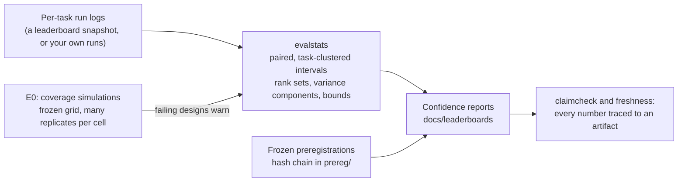

# noise-floor

**How much of a leaderboard gap is the model, and how much is noise?**

noise-floor is a toolkit and a set of preregistered studies for telling real differences between
AI agents from noise. Its library, evalstats, compares agents task by task with intervals whose
coverage is checked by simulation, and warns when a method is used where that check failed. With
it, this repository reanalyzes public agent leaderboards to show which of their orderings the
published data support, and it has frozen, before any data, a factorial study of how much of
agent success comes from the model rather than the harness, resource limits, sampling, and time.
Every result number below is generated from a banked artifact and checked by the repository's own
tools.

On Terminal-Bench 2.0, the top two submissions differ by <!-- claim:e2.tb2.top.diff -->+0.018 in task
success (95% paired CI [<!-- claim:e2.tb2.top.lo -->-0.041, <!-- claim:e2.tb2.top.hi -->+0.077]), only
<!-- claim:e2.tb2.adjacent.supported -->2 of <!-- claim:e2.tb2.adjacent.pairs -->65 adjacent pairs on
the board are statistically separated, and <!-- claim:e2.tb2.first -->15 of its
<!-- claim:e2.tb2.entries -->66 entries could plausibly rank first. In an exploratory check (not
preregistered), the smallest gap the board's own design detects
with 80% power (median over adjacent pairs) is <!-- claim:nf.tb2.mde -->0.097, the median adjacent gap is
<!-- claim:nf.tb2.gap -->0.007, and only <!-- claim:nf.tb2.atleast -->1 of the <!-- claim:e2.tb2.adjacent.pairs -->65 adjacent gaps reaches its pair's detectable gap.


| Leaderboard (confidence report) | Entries | Tasks | Adjacent pairs separated | Median rank-interval width | Could rank first | Detectable gap* | Median adjacent gap* |
|---|---:|---:|---:|---:|---:|---:|---:|
| [Terminal-Bench 2.0](docs/leaderboards/tb2.md) | <!-- claim:e2.tb2.entries -->66 | <!-- claim:e2.tb2.tasks -->89 | <!-- claim:e2.tb2.adjacent.supported -->2 of <!-- claim:e2.tb2.adjacent.pairs -->65 | <!-- claim:e2.tb2.rankwidth -->35 ranks | <!-- claim:e2.tb2.first -->15 | <!-- claim:nf.tb2.mde -->0.097 | <!-- claim:nf.tb2.gap -->0.007 |
| [SWE-bench Verified (Epoch AI)](docs/leaderboards/epoch-swebench.md) | <!-- claim:e2.epoch.entries -->32 | <!-- claim:e2.epoch.tasks -->454 | <!-- claim:e2.epoch.adjacent.supported -->3 of <!-- claim:e2.epoch.adjacent.pairs -->31 | <!-- claim:e2.epoch.rankwidth -->21 ranks | <!-- claim:e2.epoch.first -->4 | <!-- claim:nf.epoch.mde -->0.048 | <!-- claim:nf.epoch.gap -->0.004 |

Pairs are separated when their paired, task-clustered 95% interval excludes zero; rank intervals
are simultaneous 95% intervals from a task bootstrap on the tasks every entry attempted (the Tasks
column). *Exploratory, not preregistered
([`tools/noise_floor.py`](tools/noise_floor.py), [artifact](artifacts/e2/noise_floor.json)): a
pair's detectable gap is the smallest true difference in success rate that its design detects with
80% power at two-sided alpha 0.05 (normal approximation, standard error from its banked interval);
both columns are medians over adjacent pairs, and only <!-- claim:nf.tb2.atleast -->1 and <!-- claim:nf.epoch.atleast -->2
pairs, respectively, have a gap at least as large as their own detectable gap. The other columns
follow plans frozen before any interval, ordering test, rank set, or bound was computed:
[`prereg/0001`](prereg/0001-e2-leaderboard-reanalysis.md), amended for SWE-bench Verified by
[`prereg/0002`](prereg/0002-e2-amend-epoch-reference-rule.md); `make prereg-verify` checks that
each plan predates the artifacts that cite it.

**Why these numbers hold up.** Each safeguard below is a check you can run, not a promise:

- *Plans before data.* Every confirmatory analysis follows a preregistration that was frozen,
  hashed, and committed before its data existed; `make prereg-verify` checks the order.
- *No hand-typed numbers.* Each result number on this page carries a hidden marker that ties it
  to a banked artifact; `make claimcheck` and `make freshness` fail if any of them drifts.
- *Intervals tested before use.* The interval methods behind these results were checked for
  coverage by simulation at the boards' designs, all but the bounded-difference interval behind
  E3's robust counts, which has no coverage cell of its own; the library warns where a check
  failed.
- *Results recomputed from pinned data.* `make reproduce` rebuilds every E2 and E3 result from
  hash-pinned snapshots, and `make ship-check` runs fourteen gates on a fresh clone.
- *Findings published, including the unflattering ones.* The failing coverage cell, the one
  interval without a coverage cell of its own, and every review finding and what was done about
  it are on record ([docs/REVIEW_LOG.md](docs/REVIEW_LOG.md), [CORRECTIONS.md](CORRECTIONS.md)).

**Quickstart** (about a minute; after setup, nothing touches the network):

```bash
git clone https://github.com/raj200501/noise-floor && cd noise-floor
make setup    # uv sync --locked (Python 3.11 or later)
make demo     # offline demo on a synthetic fixture (no model calls); a test pins its output
uv run python docs/examples/01_compare_two_models.py
```

## Use it on your own benchmark or agent

Give evalstats one row per run (model, task, run, outcome):

```python
from evalstats import paired_difference, read_csv

results = read_csv("my_runs.csv")
cmp = paired_difference(results, "agent-a", "agent-b")  # paired by task, clustered by task
print(cmp.difference.estimate, cmp.difference.lo, cmp.difference.hi, cmp.supported)
```

```bash
uv run evalstats compare my_runs.csv --a agent-a --b agent-b   # the same from the shell
uv run evalstats rank --help                                    # also: power, decompose, report
```

## What this is

- **evalstats**, a typed Python library that makes the right analysis of eval results the
  default: paired and task-clustered comparisons, Wilson and cluster-robust intervals,
  bootstrap and mixed-model (GLMM) variance components, power and minimum detectable effects,
  simultaneous rank-confidence sets, and policy-sensitivity bounds for runs whose outcome is
  ambiguous (timeouts, infrastructure errors). Its intervals carry a validity record from
  coverage simulations (E0): a method used on a design at least as small as one where it failed
  its check emits `UnsupportedDesignWarning`. The one exception behind these results is the
  interval on a pair's bounded difference that E3's robust counts use, which has no coverage cell
  of its own. The GLMM and Wilson cells (E0's second part) run after the G6 recovery study, which is
  running; nothing from either is banked yet. API reference in [docs/api](docs/api), runnable examples in
  [docs/examples](docs/examples).
- **Confidence reports for public leaderboards** (experiments E2 and E3): each submission's score
  with an interval, every adjacent ordering tested on shared tasks, simultaneous rank intervals,
  and how the ranking moves when ambiguous runs are scored differently.
- **A preregistered factorial study of agent success** (E1), frozen with its validation plan
  before any confirmatory data: how the variance in task success splits among model, harness,
  wall-clock timeout, step budget, sampling temperature, concurrency, day, and time of day, on
  procedurally generated mock tasks, with local open-weight models and a Claude slice.
- **Integrity tooling that checks this repository's own claims**: a hash chain of frozen
  preregistrations, a claim check that ties every result number in this README and the report
  to the artifact it came from, and a ship-check of fourteen gates run on a fresh clone.

What it is not: a new benchmark, a ranking of anyone's agent, or a statement about why any
submission scored as it did. It measures how much of an observed gap a given eval design can
resolve.

## Key results

The technical report, [docs/REPORT.md](docs/REPORT.md), gives the methods, every result with
its interval, the E1 design, and the limitations in full.

| Result | Finding | Artifact | Plan |
|---|---|---|---|
| Terminal-Bench 2.0 reanalysis ([scores](docs/figures/e2-tb2-scores.svg)) | <!-- claim:e2.tb2.adjacent.supported -->2 of <!-- claim:e2.tb2.adjacent.pairs -->65 adjacent pairs separated; median rank interval <!-- claim:e2.tb2.rankwidth -->35 ranks wide | [results.json](artifacts/e2/tb2/results.json) | [`prereg/0001`](prereg/0001-e2-leaderboard-reanalysis.md) |
| SWE-bench Verified reanalysis ([scores](docs/figures/e2-epoch-swebench-scores.svg), [gaps](docs/figures/e2-epoch-swebench-gaps.svg)) | <!-- claim:e2.epoch.adjacent.supported -->3 of <!-- claim:e2.epoch.adjacent.pairs -->31 adjacent pairs separated; the leader's margin over second is <!-- claim:e2.epoch.top.diff -->+0.041 (CI <!-- claim:e2.epoch.top.lo -->+0.010 to <!-- claim:e2.epoch.top.hi -->+0.073) | [results.json](artifacts/e2/epoch-swebench/results.json) | [`prereg/0001`](prereg/0001-e2-leaderboard-reanalysis.md), [`prereg/0002`](prereg/0002-e2-amend-epoch-reference-rule.md) |
| Policy sensitivity (E3) | Adjacent orderings that hold under every scoring of ambiguous runs: <!-- claim:e3.tb2.identified -->1 of <!-- claim:e2.tb2.adjacent.pairs -->65 on Terminal-Bench (<!-- claim:e3.tb2.robust -->0 also with sampling error), <!-- claim:e3.epoch.identified -->19 of <!-- claim:e2.epoch.adjacent.pairs -->31 on SWE-bench Verified (<!-- claim:e3.epoch.robust -->3 also with sampling error); the sampling-error counts rest on an interval that has no coverage cell of its own | [bounds.json](artifacts/e3/bounds.json) | [`prereg/0001`](prereg/0001-e2-leaderboard-reanalysis.md), [`prereg/0002`](prereg/0002-e2-amend-epoch-reference-rule.md) |
| Library validity (E0 part one, synthetic) | <!-- claim:e0.cells -->22 coverage cells simulated; the cell that fails the coverage rule (the small-sample paired-difference bootstrap) is flagged as unsupported and makes the library warn; <!-- claim:e0.crosschecks -->22 cross-checks against statsmodels, SciPy, and R agree within tolerance | [coverage.json](artifacts/e0/coverage.json) | [`prereg/0003`](prereg/0003-e0-coverage-grid-part1.md) |
| Factorial study (E1) | Preregistered and frozen; not yet run, so no results; the Claude slice is pending (see Status) | n/a | [`prereg/0004`](prereg/0004-e1-factorial.md), [`prereg/0005`](prereg/0005-e0-glmm-cells.md), [`prereg/0006`](prereg/0006-g6-recovery.md) |

The study plan is in [docs/PLAN.md](docs/PLAN.md) and every design choice, with its reason, in
[DECISIONS.md](DECISIONS.md). Changed or withdrawn claims are dated in
[CORRECTIONS.md](CORRECTIONS.md).

## Status

The project defines its finish line as fourteen gates that `make ship-check` checks on a fresh
clone ([docs/GATES.md](docs/GATES.md)). In the latest fast run (`python tools/ship_check.py
--fast`, which does not count as the final check) these pass: build and tests with coverage
(G1), static quality (G2), CI parity (G3), the offline demo (G4), the library shipped as a wheel
(G9), claim integrity (G10), preregistration integrity (G11), documentation (G13), and hygiene
(G14).

Still in progress, and failing until their experiments run: library validity for E1's
intervals (G5, the second part of the E0 coverage cells), planted-component recovery of the E1 analysis
(G6), the factorial study itself (G7), the E3 bounds on E1 (G8), and the independent review of
the finished study (G12). Their plans are frozen. The validation runs behind G5 and G6 are under
way and their raw rows are committed as they arrive, but nothing from them is banked or reported
until both studies finish, and nothing in this README presents them as results.
[STATUS.md](STATUS.md) has the live table and next steps.

**The Claude slice of E1 is pending.** The Claude tiers cannot run in the hosted session where
this repository is built, whose billing guard blocks Claude children by design, so the slice
waits for a run on Raj's machine that follows the runbook in [docs/PLAN.md](docs/PLAN.md)
("Claude arm on Raj's machine"). Until it runs there are no Claude results, and G7, which
requires Claude-tier runs, cannot pass. The local arm of E1 runs here once G5 and G6 pass, but
as preregistered the E1 analysis runs only after both arms have ended. So E1 reports no result
from either arm until the slice ends, and E3 on E1 (G8) and the review of the finished study
(G12) wait for that too.

## How it works



The unit of inference is the task. Two agents scored on the same tasks are compared task by
task, and the interval is clustered on tasks, because tasks, not runs, are the scarce sample:
repeated runs of one task are correlated, and treating them as independent overstates
precision. A gap counts as resolved only when that paired interval excludes zero. Rank intervals
come from a task bootstrap of the largest studentized deviation over all pairwise gaps, so they
hold for every entry at once.

## E1: the preregistered factorial study

E1 asks how much of the variance in agent success comes from the model and how much from
everything else a leaderboard holds fixed or ignores. Its plan (frozen in
[`prereg/0004`](prereg/0004-e1-factorial.md) with its validation in
[`prereg/0005`](prereg/0005-e0-glmm-cells.md) and [`prereg/0006`](prereg/0006-g6-recovery.md)) fixes, before any
confirmatory data exist:

- the local sample, set by its power analysis: three local open-weight models on 85 mock tasks, each
  task run 18 times per model (4,590 local runs over four UTC days and two time-of-day blocks),
  plus a Claude slice of three tiers on 30 tasks, sized by the usage caps, not by power;
- a half-fraction factorial over harness, timeout, step budget, temperature, and concurrency,
  crossed with model, day, and time-of-day block, with replicate runs to measure run-to-run
  sampling directly;
- a logit GLMM decomposition with parametric-bootstrap and task-jackknife intervals, whose
  coverage is checked first on synthetic data shaped like E1 (E0 part 2 and the planted-component
  recovery study G6);
- Holm-adjusted contrast tests within each of six families, with power computed for the Holm
  reading (the eight fixed-factor readings are unadjusted), and the labels a reader needs
  (underpowered families, intervals outside their validated range);
- operational rules: pinned model files and server build, run-code checks before every batch,
  stop rules for infrastructure failures, and local runs sandboxed with no external network.

## Reproduce

```bash
make reproduce     # recomputes E2 and E3 from the pinned snapshots; fails if a result or figure differs
make ship-check    # all fourteen gates on a fresh clone; gates that wait on E1 fail until it runs
```

`make claimcheck` and `make freshness` check that every result number in this README and in
[docs/REPORT.md](docs/REPORT.md) equals what its artifact says now; `make prereg-verify` checks
that every preregistration is frozen, unedited, and older than the data that cite it. The
leaderboard snapshots are pinned by URL, retrieval date, and hash in [docs/DATA.md](docs/DATA.md).

## Limitations and threats to validity

- The reanalysis takes each board's published per-task results as given. Entries differ in runs
  per task, and the boards score ambiguous runs in their own ways; E3 shows how far that moves
  the ranking.
- Intervals describe uncertainty about a population of tasks like the benchmark's, not about the
  fixed tasks themselves. Adjacent-pair intervals are per comparison and unadjusted, so a
  multiplicity-adjusted reading cannot separate more pairs; only the rank intervals are simultaneous.
- Coverage is validated by simulation at designs like these (for E3, on per-entry bounds only),
  not guaranteed elsewhere; the failing cell (the small-sample paired-difference bootstrap) makes
  the library warn.
- E1 has not run. Its tasks are procedurally generated mock tasks, so its results, once banked,
  will be results on those tasks, not on real-world work.

## Responsible reporting

This project reports statistical resolution only. It does not assess any submission's
correctness, never speculates about why an entry scored as it did, and states for every ordering
whether it is or is not statistically supported. The data are used under their licenses
(Apache-2.0 and CC-BY-4.0; see [docs/DATA.md](docs/DATA.md)).

## Related work

Every reference below was opened and checked (title, authors, year, URL) and is recorded in
[artifacts/citecheck.json](artifacts/citecheck.json).

- [Adding Error Bars to Evals: A Statistical Approach to Language Model Evaluations](https://arxiv.org/abs/2411.00640) (Miller)
- [Signal and Noise: A Framework for Reducing Uncertainty in Language Model Evaluation](https://arxiv.org/abs/2508.13144) (Heineman and others)
- [Quantifying infrastructure noise in agentic coding evals](https://www.anthropic.com/research/infrastructure-noise) (Anthropic)
- [Clarifying limitations of time horizon](https://metr.org/notes/2026-01-22-time-horizon-limitations/) (METR)
- [Measuring what Matters: Construct Validity in Large Language Model Benchmarks](https://arxiv.org/abs/2511.04703) (Bean and others)
- [tinyBenchmarks: evaluating LLMs with fewer examples](https://arxiv.org/abs/2402.14992) (Polo and others)
- [Inference for Ranks with Applications to Mobility across Neighbourhoods and Academic Achievement across Countries](https://doi.org/10.1093/restud/rdad006) (Mogstad and others)
- [Confidence Intervals for Partially Identified Parameters](https://doi.org/10.1111/j.1468-0262.2004.00555.x) (Imbens and Manski)
- [Terminal-Bench: Benchmarking Agents on Hard, Realistic Tasks in Command Line Interfaces](https://arxiv.org/abs/2601.11868) and [SWE-bench](https://arxiv.org/abs/2310.06770), the benchmarks reanalyzed here

## How this was built

Raj Kashikar built this with Claude Code working as an autonomous research engineer from a
written brief ([docs/BUILD_BRIEF.md](docs/BUILD_BRIEF.md)), under rules the repository enforces
on itself: no hand-typed result numbers, preregistration before confirmatory data, failures
published beside successes, and no paid compute. Progress and open items are in
[STATUS.md](STATUS.md).

## Citation and license

Cite with [CITATION.cff](CITATION.cff). Code under the [MIT License](LICENSE); leaderboard data
under their own licenses ([docs/DATA.md](docs/DATA.md)).
